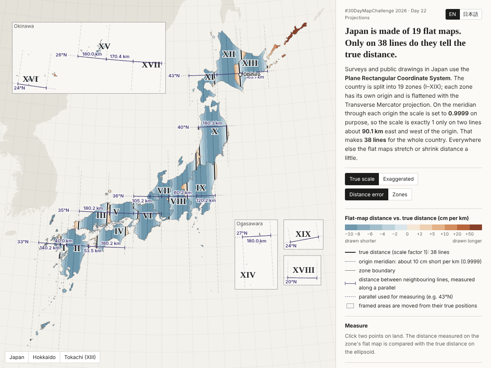

# Japan is made of 19 flat maps

**#30DayMapChallenge 2026 · Day 22 Projections**

> Japan is made of 19 flat maps. Only on 38 lines do they tell the true distance.
>
> 日本は19枚の平らな地図でできている。本当の距離を示すのは、38本の線の上だけ。

公開URL: https://shinyanakashima.github.io/30daymapchallenge-2026day22-plane-rectangular/



## 作品について

日本の測量や公共の図面に使われる「平面直角座標系」を題材にした Web アプリです。英語表記が基本で、日本語に切り替えられます（`?lang=ja` でも指定できます）。

- 日本全体を19の区域（第I系〜第XIX系）に分け、区域の中を「1kmあたり何cm 長く・短く描かれるか」で塗り分けています。
- 各区域で縮尺がちょうど1倍になる2本の線（合計38本）を黒い実線で描いています。陸地の外にのびる部分は破線です。原点を通る南北の線（縮尺0.9999）は点線です。
- 帯広（第XIII系）を例として示しています。「北海道」「十勝（第XIII系）」のボタンで拡大できます。
- 隣り合う本当の距離の線の間の距離を、1度ごとの緯線に沿ってはかって地図に書き込んでいます（同じ組み合わせは一度だけ）。はかった緯線は点線と緯度（例：43°N）で示しています。画面右の一覧の行をクリックすると、その区間へ拡大します。
- 地図上の2点をクリックすると、その系の平らな地図で測った距離と、楕円体の上の本当の距離を並べ、差を cm で表示します。2点が別の系にあるときは、別々の平面にあるため、そのままでは測れないと表示します。
- 「誇張」モードでは、歪みを数百倍（初期値500倍、100〜1000倍で変更可）に誇張し、19枚の平らな地図をそれぞれの位置に置いたときに、区域の境目にできる隙間や重なりを見せます。倍率は画面上部に常に表示します。
- 沖縄（第XV〜XVII系）と遠い島の系（第XIV系 小笠原、第XVIII系 沖ノ鳥島、第XIX系 南鳥島）は、位置をずらした枠で示しています。

URL パラメータ: `lang=ja|en`、`view=japan|hokkaido|tokachi`、`mode=exag`

## 平面直角座標系とは

平面直角座標系は、平成14年国土交通省告示第9号（最終改正 平成22年国土交通省告示第289号）で定められた座標系です。日本を19の区域に分け、区域ごとに原点を置き、ガウス・クリューゲル型の横メルカトル図法で平面に投影します。X軸は原点を通る子午線（北が正）、Y軸はそれに直交する線（東が正）で、原点の座標は X = 0、Y = 0 です。

原点を通る子午線の上の縮尺係数は 0.9999 です。横メルカトル図法では子午線から東西に離れるほど縮尺が大きくなるため、縮尺係数がちょうど1になるのは、原点を通る子午線から東西に約90km 離れた2本の線の上です。19区域で38本になります。それ以外の場所では、平らな地図は距離をわずかに縮めて（線の内側）または伸ばして（線の外側）描いています。

| 原点の緯度 | 該当する系 | 縮尺1倍の線（原点の緯度での、原点を通る子午線からの距離） |
|---|---|---|
| 北緯20度 | XVIII | 89.963 km |
| 北緯26度 | XIV, XV, XVI, XVII, XIX | 90.009 km |
| 北緯33度 | I, II, IV | 90.072 km |
| 北緯36度 | III, V, VI, VII, VIII, IX | 90.101 km |
| 北緯40度 | X | 90.142 km |
| 北緯44度 | XI, XII, XIII | 90.184 km |

線の位置は緯度によってわずかに変わり、各系の陸地がある緯度の範囲では 89.97〜90.20 km です。原点を通る子午線の上の距離のずれは 1kmあたり −10 cm です。

### 帯広

帯広市役所（北緯42.92389度、東経143.19633度）は第XIII系の原点から西に 86.015 km、南に 119.007 km の位置にあります。

- 縮尺係数: 0.99999099
- 距離のずれ: 1kmあたり約 −0.90 cm（1km が約0.9 cm 短く描かれる）
- その緯度での縮尺1倍の線は原点から 90.173 km。帯広は線から原点側に約 4.2 km の位置にあり、38本の線のほぼ真上にあります。

## 計算の方法

1. **区域の割り当て**: 国土数値情報 N03（行政区域）の各ポリゴンに、告示の「適用区域」に従って系の番号を割り当てました（`scripts/zones.py`、`scripts/assign_zones.py`）。
   - 都府県単位の系はそのまま割り当てます。
   - 北海道は、告示に挙げられた市と振興局・町の名前で第XI・XII・XIII系に分けます。
   - 鹿児島県の第I系（北緯27〜32度、東経128度18分〜130度、奄美群島は東経130度13分まで）、沖縄県の第XV〜XVII系（東経126度・130度で区分）、東京都の第XIV・XVIII・XIX系（北緯28度以南を東経140度30分・143度で区分）は、島ごとのポリゴンの代表点の緯度経度で判定します。
2. **区域の形**: mapshaper で系ごとに市町村を結合（dissolve）し、隣り合う区域の境界を共有したまま簡略化（間隔100m）しました。
3. **縮尺係数と距離のずれ**: 各系（EPSG:6669〜6687、JGD2011 / GRS80楕円体、縮尺係数0.9999）について、pyproj の `Proj.get_factors` で点の縮尺係数 k を求め、縮尺係数が 1、および距離のずれが −8、−6、−4、−2、0、+2、+5、+10、+20、+50 cm/km となる線を二分法で計算しました（`scripts/build_data.py`）。距離のずれは (k − 1) × 100,000 cm/km です。ブラウザでのマウス位置の表示には、横メルカトル図法の縮尺係数の級数式を使い、pyproj の値と 1×10⁻⁸ 以内で一致することを確かめています（`scripts/check.mjs`）。
4. **距離の計測**: 平らな地図の距離は、proj4js（`etmerc`）で求めた平面直角座標での2点間の直線距離です。本当の距離は、GeographicLib で求めた GRS80楕円体上の測地線の長さです。どちらも pyproj の値と 1 mm 以内で一致することを確かめています。
5. **隣り合う線の間の距離**: 1度単位の緯度（北緯43度：第XI〜XIII系、40度：第X系、36度：第VI〜IX系、35度：第III・V・VI系、33度：第I・II・IV系、27度：第XIV系、26度：第XV・XVII系、24度：第XVI系・第XIX系（枠が別のため別々に比較）、20度：第XVIII系）ごとに、その緯度で縮尺係数が1になる経度を pyproj で求め、西から東へ並べて、隣り合う2本の間の GRS80楕円体上の距離を求めました（`scripts/build_gaps.py`）。同じ組み合わせは一度だけ載せています。隣の系の線とは交差しているため、ある系の線が隣の系の2本の線の間に入ります。
6. **背景**: 日本以外の陸地（Natural Earth、日本を除いて簡略化、`scripts/build_bg.py`）と1度ごとの経緯線を、全国の基図の上に薄く描いています。枠の中には描いていません。
7. **誇張モード**: 各頂点について、その系の平面直角座標と、系の原点を中心とする正距方位図法（原点からの本当の距離と方位を保つ）での座標の差を求めます。この差を表示中の倍率で拡大し、全国の基図（ランベルト正角円錐図法、標準緯線 北緯33度・43度、中央経線 東経137度）の位置に加えています。各系の地図は原点で固定されるため、区域の境目でずれが隙間や重なりとして現れます。

### 隣り合う線の間の距離（主なもの）

| 緯度 | 隣り合う線 | 距離 |
|---|---|---|
| 北緯43度 | 第XII系 西 – 第XI系 東 | 17.3 km |
| 北緯43度 | 第XIII系 西 – 第XII系 東 | 17.3 km |
| 北緯43度 | 第XI系 東 – 第XIII系 西 | 145.8 km |
| 北緯40度 | 第X系 西 – 第X系 東 | 180.3 km |
| 北緯36度 | 第VI系 東 – 第VIII系 西 | 45.2 km |
| 北緯36度 | 第VIII系 西 – 第VII系 東 | 60.0 km |
| 北緯35度 | 第III系 東 – 第V系 西 | 17.6 km |
| 北緯33度 | 第II系 西 – 第I系 東 | 40.0 km |
| 北緯26度 | 第XV系 東 – 第XVII系 西 | 170.4 km |

全30組は `web/data/gaps.json` と画面の一覧にあります。

### 再生成

```sh
pip install -r requirements.txt
npm install
scripts/build.sh path/to/N03-20250101.shp   # web/data を作り直す
npm run check                                # 表示確認とスクリーンショット（docs/screenshot.png）
```

`web/` をそのまま静的に配信すれば動きます。GitHub Pages へは `.github/workflows/pages.yml` でデプロイします。

## データの出典

| データ | 取得元 | 取得日 |
|---|---|---|
| 平面直角座標系（平成14年国土交通省告示第9号）の各系の原点と適用区域 | 国土地理院「わかりやすい平面直角座標系」 https://www.gsi.go.jp/sokuchikijun/jpc.html 、告示本文 https://www.gsi.go.jp/LAW/heimencho.html | 2026年11月7日 |
| 行政区域（N03、2025年1月1日時点、全国） | 国土数値情報ダウンロードサイト https://nlftp.mlit.go.jp/ksj/gml/datalist/KsjTmplt-N03-2025.html | 2026年11月7日 |
| 背景の陸地（日本以外） | Natural Earth 1:10m Admin 0 Countries（npm パッケージ world-atlas 2.0.2 の countries-10m.json） | 2026年11月20日 |
| 投影の定義 | EPSG:6669〜6687（JGD2011 / Japan Plane Rectangular CS I〜XIX） | — |

出典：国土地理院（平面直角座標系）、国土数値情報（行政区域データ）を加工して作成。背景の陸地は Natural Earth。

使用ライブラリ: [d3](https://d3js.org/)（ISC）、[proj4js](https://github.com/proj4js/proj4js)（MIT）、[GeographicLib](https://geographiclib.sourceforge.io/)（MIT）、[pyproj](https://pyproj4.github.io/pyproj/)、[GeoPandas](https://geopandas.org/)、[Shapely](https://shapely.readthedocs.io/)、[mapshaper](https://github.com/mbloch/mapshaper)

## 注記

- 縮尺係数と距離のずれは、横メルカトル図法の式で計算した理論値です（楕円体面上の値で、標高による補正は含みません）。
- 区域の境界は、告示の市町村単位で作りました。緯度・経度で決められた島の区域は、その範囲で分けています。境界の形は簡略化しています。
- 誇張モードは歪みを誇張しており、実際の縮尺ではありません。
- 沖縄と遠い島の系は、位置をずらした枠で示しています。
